# SQLFluff — adaptation map

> English translation of the human view. The arm B sessions read the Turkish original in `original-tr/examples/sqlfluff-blueprint/README.md`. `map.yaml`, the source of truth, is kept in its original Turkish.
>
> This file is derived from `map.yaml` and adds no new claims. The ids in parentheses (`INV-07`, `E1`, `S3` …) refer to entries in `map.yaml`; see it for the evidence (`file:line`).
> For coding standards, test commands and writing dialect grammars, see the repo's `AGENTS.md` files; this map focuses on what they do not say.

## 1. One sentence

SQLFluff is a dialect-flexible linter/formatter that templates SQL files (jinja/python/placeholder/raw or a plugin), lexes and parses them with the selected dialect's grammar, runs rules over the segment tree to report violations, and patches fixes back into the source file.

## 2. On one page

**Entry points:** the `sqlfluff` CLI (`lint`, `fix`, `format`, `parse`, `render`, `rules`, `dialects`), `python -m sqlfluff`, the Python API (`sqlfluff.lint/fix/parse`), the `Linter` class, the diff-quality plugin.

**Stages** (P1–P11):

```mermaid
flowchart LR
  P1[P1 config-root<br/>CLI overrides + config layers] --> P2[P2 discovery<br/>extension + ignore, sorted]
  P2 --> P3[P3 runner<br/>sequential / process / thread]
  P3 --> P4[P4 load-file<br/>child config, encoding, size, inline config]
  P4 --> P5[P5 templating<br/>newline normalisation, ≤5 variants]
  P5 --> P6[P6 lexing<br/>dialect matchers]
  P6 --> P7[P7 parsing<br/>root_parse, unparsable → PRS]
  P7 --> P8[P8 rule-loop<br/>noqa, main+post phase, apply_fixes]
  P8 --> P9[P9 aggregate<br/>variant merge, ignore/warnings, dedupe]
  P9 --> P10[P10 patch-persist<br/>source patches, temp file]
  P9 --> P11[P11 report-exit<br/>format, exit code]
  P10 --> P11
```

**Core / domain split:**

| Layer | Where | Note |
|---|---|---|
| core | `core/parser/`, `core/dialects/base.py`, `core/templaters/base.py`, `core/linter/`, `core/rules/`, `core/plugin/`, `core/errors.py`, `core/formatter.py`, `core/helpers/`, `utils/functional/`, `utils/testing/`, `api/` | The parse engine knows no dialect names (S1) |
| domain | `dialects/` (28 dialects, ~94k lines), `rules/` (79 rules), `core/templaters/{jinja,python,placeholder}.py`, `core/default_config.cfg`, `utils/analysis/`, `plugins/*` | Families: F1 dialects, F2 rules, F3 templaters |
| mixed | `core/dialects/__init__.py` (registry table), `core/dialects/common.py` (bigquery dispatch), `core/config/` (templater names), `core/linter/discovery.py` (ignore file names), `core/rules/noqa.py` (`--` comment syntax), `utils/reflow/` (segment type names), `cli/` (output formats), `sqlfluffrs/` | Where domain knowledge leaks into the core |

**Seams:** the dialect library + `Ref` (S1, explicit); dialect registration is a fixed table (S2, embedded, no plugin hook); the templater interface (S3, explicit); rule plugin hooks (S4, explicit); `get_templaters` without a hookspec (S5); segment `type` strings (S6, embedded); dialect-name comparisons inside rules (S7, embedded); `FormatterInterface` (S8); the Rust bridge (S9); output formats inside the lint command (S10, embedded).

**The 5 most important invariants:**

1. CLI fix does not write a file with an unfiltered TMP/PRS error; `--ignore parsing` and noqa do not change that, only `--FIX-EVEN-UNPARSABLE` does (INV-34). The Python API instead uses the filtered count and fixes with `ignore=parsing` (INV-55).
2. If the fix loop reaches `runaway_limit` (10), all fixes are discarded and the original tree is returned (INV-37); fixes that make the file unparsable or return it to an earlier state are not applied (INV-38).
3. Config precedence: default < appdir < ~ < parents < cwd→file directory < `--config` < CLI < in-file `-- sqlfluff:`; an in-file directive overrides even `--dialect` (INV-06, INV-07).
4. Exit codes are 0/1/2 (INV-17); but a per-file internal error is only a warning and can return 0 (INV-28); an unknown rule reference returns 0 without running any rule (INV-19); an explicit file with a non-matching extension is silently skipped (INV-21).
5. Line endings are normalised to `\n`: a CRLF file that gets a fix is written as LF (INV-42); fix with a wrong `--encoding` turns bytes into literal `\xNN` text (INV-43).

## 3. Adaptation guide

### E1 — New SQL dialect
Mechanism: the fixed `_dialect_lookup` table + a `copy_as` copy of the parent; segment classes with the same name in the module are added or replaced automatically (S1, S2, F1).
- [ ] `src/sqlfluff/dialects/dialect_<name>.py`: `load_raw_dialect('<parent>').copy_as(...)`, lexer patches, `.replace/.add`, segment classes
- [ ] `dialect_<name>_keywords.py`: reserved/unreserved lists
- [ ] `core/dialects/__init__.py:23`: registry entry
- [ ] `test/fixtures/dialects/<name>/`: `.sql` + generated `.yml`
- [ ] `sqlfluffrs/tests/fixture_tests.rs`: two hand-written parity tests; the Rust sources are generated with `utils/rustify.py build`
- [ ] If the parent is mysql, `rules/convention/CV11.py:26`; scan the S7 files for other dialect-name checks (A7)
- [ ] `test/cli/autocomplete_test.py:14`, `README.md:66`

Related invariants: INV-16, INV-30, INV-31, INV-41. Keep segment `type` names (S6); `Dialect.replace` rejects a different `type`.

### E2 — New lint rule
Mechanism: class name `Rule_LLNN` / `Rule_Plugin_LLNN` → code; first docstring line → description; the package's `get_rules` hookimpl (S4, F2).
- [ ] `rules/<package>/<CODE>.py`: docstring, `groups` (`'all'` required), `name` (lower case, dotted), `crawl_behaviour`, `is_fix_compatible`, `_eval`
- [ ] The package `__init__.py`: the `get_rules()` list; `get_configs_info()` if there is a new config key
- [ ] Every key in `config_keywords` needs a default in `default_config.cfg` (or the plugin's config) (INV-57)
- [ ] A `pyproject.toml` entry point if it is a new package
- [ ] `test/fixtures/rules/std_rule_cases/<CODE>.yml` (`rule: <CODE>`)

Related invariants: INV-03 (rules run in code order), INV-20, INV-29, INV-37, INV-39, INV-45, INV-46.

### E3 — New templater
Mechanism: a `RawTemplater` subclass + a `get_templaters` hookimpl; config `templater = <name>` (S3, S5, F3).
- [ ] `name`, `process` / `process_with_variants`; if needed `sequence_files`, `templates_in_worker=False`
- [ ] The `core_templaters` list if core, `get_templaters` if a plugin
- [ ] The `core/config/toml.py:58` list if context arrays should stay typed; `_path/_dir` keys are exempt from path resolution only in the jinja context (A5, A6)
- [ ] If jinja-like, deriving from `JinjaTemplater` enables JJ01

Related invariants: INV-11 (the templater cannot be changed in a subdirectory), INV-40, INV-47, INV-51.

### E4 — New CLI output format
Mechanism: the `FormatType` enum + an `if/elif` serialiser inside `lint` (S10, F4).
- [ ] The value in `core/types.py:20`
- [ ] The branch in `cli/commands.py:829`
- [ ] The `parse` command accepts only human/json/yaml/none (`cli/commands.py:1693`)
- [ ] In non-human formats, human output goes to devnull

Related invariants: INV-18, INV-22.

### E5 — New CLI command or option
Mechanism: `@cli.command()` + `common_options/core_options/lint_options`; kwargs that are not None become `core` overrides.
- [ ] A flag whose name matches a core config key becomes an automatic override (only the `core` section)
- [ ] The `default_config.cfg` default and, if needed, validation in `validate.py`

Related invariants: INV-06, INV-17, INV-22, INV-24.

### E6 — New config / ignore file type
- [ ] The precedence list in `core/config/loader.py:225`
- [ ] `core/config/file.py:38`: every file other than pyproject is read as ini
- [ ] `core/linter/discovery.py:109`: the loader, if `ignore_paths` should be read

Related invariants: INV-06, INV-08, INV-09.

### E7 — New runner / parallelism
- [ ] Selection in `core/linter/runner.py:370`; `BaseRunner.run` must swallow exceptions through `_handle_lint_path_exception`

Related invariants: INV-28, INV-48.

### E8 — A rule or dialect change on the Rust side
- [ ] Override `BaseRule._eval_rust`; `use_rust_rules` on with the parser off is an error (see `sqlfluffrs/AGENTS.md`)

Related invariants: INV-53, INV-54.

## 4. Module details

- **`core/linter/linter.py`** (core orchestration). Flow: `lint_paths` → runner → `render_file` (`load_raw_file_and_config` → `render_string`) → `lint_rendered` → `parse_rendered` (`_lex_templated_file`, `_parse_tokens`) → `lint_parsed` → `lint_fix_parsed` → `BaseRule.crawl` / `apply_fixes` → `LintedFile` → `persist_tree`. Decisions: `render_string` requires a dialect and limits variants; `_parse_tokens` chooses Rust or Python and produces PRS; `lint_fix_parsed` handles phases, the loop limit and fix validity; `lint_parsed` merges variants and handles ignore/warnings.
- **`core/rules/base.py`**. `RuleMetaclass` generates code and description; `crawl` turns exceptions into violations; `_process_lint_result` drops template-unsafe fixes and unparsable parents; `rule_reference_map` resolves code > name > group > alias; `get_rulepack` expands allow/deny lists and instantiates rules in order.
- **`cli/commands.py`**. `get_config` turns the CLI into overrides; `lint` decides the output stream, format and exit code; `_handle_unparsable` discards fixes for files with TMP/PRS; `_paths_fix` / `_stdin_fix` handle persistence and the exit code.
- **`core/parser/`** — the dialect-independent engine: lexer, grammar combinators, matching algorithms, the segment tree. `rust_parser.py` converts the Rust result into a Python tree when sqlfluffrs is present.
- **`core/dialects/`** — `base.py` is `Dialect` (add/replace/copy_as/expand/lexer patches); `__init__.py` is the fixed registry table; `common.py` has reference helpers chosen by dialect name (bigquery special case).
- **`dialects/`** — 28 dialects. Inheritance: postgres → duckdb, greenplum, materialize, redshift; mysql → mariadb, doris, starrocks; hive → impala; sparksql → databricks; the rest from ansi. Representative member: `dialect_sqlite.py`.
- **`core/templaters/`** — `base.py` is the interface and `TemplatedFile`; concrete jinja, python, placeholder; jinja produces multiple variants and uses a SandboxedEnvironment.
- **`core/config/`** — discovery, ini/toml reading, `_path/_dir` path resolution, validation, `FluffConfig`.
- **`core/default_config.cfg`** — all defaults; layout sections for 62 segment types.
- **`core/rules/noqa.py`** — noqa parsing; assumes the `--` comment syntax.
- **`core/plugin/`** — the pluggy host; hookspecs `get_rules`, `load_default_config`, `get_configs_info`.
- **`rules/`** — 79 rules in 11 packages. Representative member: `layout/LT01.py` (logic lives in `utils/reflow`).
- **`utils/reflow/`** — the spacing/breaking/indentation engine; reads config by segment type.
- **`utils/analysis/`** — SELECT/CTE analysis. **`utils/functional/`** — segment query helpers. **`utils/testing/`** — test helpers for plugins.
- **`api/`** — a thin facade. **`plugins/`** — the dbt and sqlmesh templaters and an example rule plugin. **`sqlfluffrs/`** — the experimental Rust lexer/parser/rules.

**Assumptions to watch:** file recognition by extension (A1); fixed config/ignore file names (A2); the `--` comment syntax (A4); templater names embedded in the config loader (A5); keys with `_path/_dir` suffixes treated as paths (A6); dialect-name lists inside rules (A7, A8); the error codes TMP/LXR/PRS/NOQA (A9); the lexer's dependency on the `whitespace` matcher name (A11); the segment types reflow knows (A15).

## 5. Documentation discrepancies

| Source | Says | The code does |
|---|---|---|
| `docs/source/production/cli_use.rst:18-20` | Exit 2 means an internal error | A per-file internal error is only a warning; exit can be 0 (observed) |
| `cli/commands.py:688` (`--write-output` help) | An output file re-enables stdout logging | Logs go to stderr; stdout stays empty (observed) |
| `ignoring_configuration.rst:114` | The `ignore` setting lives in `.sqlfluffignore` | `.sqlfluffignore` holds only gitignore patterns; `ignore` is a config key |
| `ignoring_configuration.rst:88-91` | `ignore_paths` in pyproject.toml | Also read from `.sqlfluff`; not read from setup.cfg/tox.ini |
| `core/config/loader.py:286` (docstring, three more times in fluffconfig.py) | `ignore_local_config` skips only ~ and appdir | Parent and project configs are skipped too (observed) |
| `setting_configuration.rst:146-148` | The macOS/Unix config dir is `~/.config/sqlfluff` | Falls back to the XDG unix path, then the platformdirs macOS path |
| `setting_configuration.rst:8-9` | Templating config only through files | There is a `--library-path` CLI override |
| `default_config.cfg:8` | verbose 0–2 | 3, 4 and >4 are separate log levels |
| `default_config.cfg:15` | templater raw/jinja/python/placeholder | Plugin templaters are valid too |
| `AGENTS.md:135` | Define `code` and `description` for a rule | The metaclass generates them from the class name and docstring and overwrites them |
| `AGENTS.md:137`, `test/AGENTS.md:230, 441` | YAML cases are `<category>.yml` | Files are named by rule code (`AL01.yml`); the rule comes from the `rule:` key |
| `src/sqlfluff/AGENTS.md:245` | `from_root()` defaults to the `ansi` dialect | The default is `None`; no dialect is an error |

## 6. Unknowns

- Does `--library-path none` really turn off jinja's `library_path`? With a `None` override the code may fall back to the templater section; the CLI test assumes it turns it off.
- Since `RawTemplater.__eq__` uses isinstance, can the subdirectory warning be skipped for a python ↔ jinja templater mismatch? (guess)
- Is fix idempotent when run twice? No general guarantee or test was found.
- Do the observations hold on the Rust parser path? All observations were made without sqlfluffrs.
- Could rule globs be case-insensitive on Windows? (guess)
- Do internal-error and skipped-file counts in MultiProcessRunner match the sequential runner? Not examined.
- **Not examined:** individual dialect grammars, the internal logic of the 79 rules, `templaters/slicers/tracer.py`, the internal algorithm of `utils/reflow/reindent.py`, the internals of the sqlfluffrs crates, the internal logic of the dbt/sqlmesh plugins.
