# SQLFluff — uyarlama haritası

> Bu dosya `map.yaml`'dan türetilmiştir ve yeni iddia eklemez. Parantez içindeki kimlikler (`INV-07`, `E1`, `S3` …) `map.yaml`'daki kayıtlara karşılık gelir. Kanıt (`dosya:satır`) için oraya bakın.
> Kod yazım standartları, test komutları ve dialekt grammar yazımı için repodaki `AGENTS.md` dosyalarına bakın; bu harita onların söylemediklerine odaklanır.

## 1. Tek cümle

SQLFluff, SQL dosyalarını şablonlayıp (jinja/python/placeholder/raw ya da eklenti), seçilen dialektin grammar'ıyla lexleyip parse eden, segment ağacı üzerinde kurallar çalıştırıp ihlal raporlayan ve düzeltmeleri kaynak dosyaya geri yamalayan dialekt-esnek bir linter/formatlayıcıdır.

## 2. Bir sayfada

**Giriş noktaları:** `sqlfluff` CLI (`lint`, `fix`, `format`, `parse`, `render`, `rules`, `dialects`), `python -m sqlfluff`, Python API (`sqlfluff.lint/fix/parse`), `Linter` sınıfı, diff-quality eklentisi.

**Aşamalar** (P1–P11):

```mermaid
flowchart LR
  P1[P1 config-root<br/>CLI override + config katmanları] --> P2[P2 discovery<br/>uzantı + ignore, sıralı]
  P2 --> P3[P3 runner<br/>sequential / process / thread]
  P3 --> P4[P4 load-file<br/>çocuk config, encoding, boyut, inline config]
  P4 --> P5[P5 templating<br/>newline normalize, ≤5 varyant]
  P5 --> P6[P6 lexing<br/>dialekt matcher'ları]
  P6 --> P7[P7 parsing<br/>root_parse, unparsable → PRS]
  P7 --> P8[P8 rule-loop<br/>noqa, main+post faz, apply_fixes]
  P8 --> P9[P9 aggregate<br/>varyant birleşimi, ignore/warnings, dedupe]
  P9 --> P10[P10 patch-persist<br/>kaynak yamaları, geçici dosya]
  P9 --> P11[P11 report-exit<br/>format, exit kodu]
  P10 --> P11
```

**Çekirdek / alan ayrımı:**

| Katman | Yer | Not |
|---|---|---|
| core | `core/parser/`, `core/dialects/base.py`, `core/templaters/base.py`, `core/linter/`, `core/rules/`, `core/plugin/`, `core/errors.py`, `core/formatter.py`, `core/helpers/`, `utils/functional/`, `utils/testing/`, `api/` | Parse motoru dialekt adı bilmez (S1) |
| domain | `dialects/` (28 dialekt, ~94k satır), `rules/` (79 kural), `core/templaters/{jinja,python,placeholder}.py`, `core/default_config.cfg`, `utils/analysis/`, `plugins/*` | Aileler: F1 dialektler, F2 kurallar, F3 templater'lar |
| mixed | `core/dialects/__init__.py` (kayıt tablosu), `core/dialects/common.py` (bigquery dispatch), `core/config/` (templater adları), `core/linter/discovery.py` (ignore dosya adları), `core/rules/noqa.py` (`--` yorum sözdizimi), `utils/reflow/` (segment türü adları), `cli/` (çıktı formatları), `sqlfluffrs/` | Alan bilgisinin çekirdeğe sızdığı yerler |

**Dikişler:** dialekt kütüphanesi + `Ref` (S1, açık); dialekt kaydı sabit tablo (S2, gömülü — eklenti hook'u yok); templater arayüzü (S3, açık); kural eklentisi hook'ları (S4, açık); `get_templaters` hookspec'siz (S5); segment `type` dizgeleri (S6, gömülü); kurallarda dialekt adı karşılaştırmaları (S7, gömülü); `FormatterInterface` (S8); Rust köprüsü (S9); çıktı formatları lint komutunun içinde (S10, gömülü).

**En önemli 5 değişmez:**

1. CLI fix, filtrelenmemiş TMP/PRS hatası olan dosyaya yazmaz; `--ignore parsing` ya da noqa bunu açmaz, yalnız `--FIX-EVEN-UNPARSABLE` açar (INV-34). Python API ise filtrelenmiş sayımı kullanır ve `ignore=parsing` ile düzeltir (INV-55).
2. Fix döngüsü `runaway_limit`'e (10) ulaşırsa tüm fix'ler atılır ve orijinal ağaç döner (INV-37); fix'ler dosyayı parse edilemez yaparsa ya da eski bir duruma döndürürse uygulanmaz (INV-38).
3. Config önceliği: varsayılan < appdir < ~ < ebeveynler < cwd→dosya dizini < `--config` < CLI < dosya içi `-- sqlfluff:`; dosya içi direktif `--dialect`'i bile ezer (INV-06, INV-07).
4. Çıkış kodları 0/1/2 (INV-17); ama dosya başına iç hata yalnız uyarıdır ve 0 dönebilir (INV-28); bilinmeyen kural referansı hiçbir kural çalıştırmadan 0 döner (INV-19); uzantısı uymayan açık dosya sessizce atlanır (INV-21).
5. Satır sonları `\n`'e normalize edilir: fix uygulanan CRLF dosya LF olarak yazılır (INV-42); yanlış `--encoding` ile fix baytları `\xNN` metnine çevirir (INV-43).

## 3. Uyarlama rehberi

### E1 — Yeni SQL dialekti
Mekanizma: sabit `_dialect_lookup` tablosu + ebeveynin `copy_as` kopyası; modüldeki aynı adlı segment sınıfları otomatik eklenir/değiştirilir (S1, S2, F1).
- [ ] `src/sqlfluff/dialects/dialect_<ad>.py`: `load_raw_dialect('<ebeveyn>').copy_as(...)`, lexer yamaları, `.replace/.add`, segment sınıfları
- [ ] `dialect_<ad>_keywords.py`: reserved/unreserved listeleri
- [ ] `core/dialects/__init__.py:23`: kayıt girdisi
- [ ] `test/fixtures/dialects/<ad>/`: `.sql` + üretilen `.yml`
- [ ] `sqlfluffrs/tests/fixture_tests.rs`: elle yazılan iki parite testi; Rust kaynakları `utils/rustify.py build` ile üretilir
- [ ] Ebeveyn mysql ise `rules/convention/CV11.py:26`; diğer dialekt-adı kontrolleri için S7 dosyalarını tara (A7)
- [ ] `test/cli/autocomplete_test.py:14`, `README.md:66`

İlgili değişmezler: INV-16, INV-30, INV-31, INV-41. Segment `type` adlarını koru (S6); `Dialect.replace` farklı `type`'ı reddeder.

### E2 — Yeni lint kuralı
Mekanizma: sınıf adı `Rule_LLNN` / `Rule_Plugin_LLNN` → kod; docstring ilk satırı → açıklama; paket `get_rules` hookimpl'i (S4, F2).
- [ ] `rules/<paket>/<KOD>.py`: docstring, `groups` (`'all'` zorunlu), `name` (küçük harf, noktalı), `crawl_behaviour`, `is_fix_compatible`, `_eval`
- [ ] Paket `__init__.py`: `get_rules()` listesi; yeni config anahtarı varsa `get_configs_info()`
- [ ] `config_keywords`'teki her anahtarın varsayılanı `default_config.cfg` (ya da eklenti config'i) içinde olmalı (INV-57)
- [ ] Yeni paketse `pyproject.toml` entry-point
- [ ] `test/fixtures/rules/std_rule_cases/<KOD>.yml` (`rule: <KOD>`)

İlgili değişmezler: INV-03 (kurallar kod sırasıyla çalışır), INV-20, INV-29, INV-37, INV-39, INV-45, INV-46.

### E3 — Yeni templater
Mekanizma: `RawTemplater` alt sınıfı + `get_templaters` hookimpl'i; config `templater = <name>` (S3, S5, F3).
- [ ] `name`, `process` / `process_with_variants`; gerekirse `sequence_files`, `templates_in_worker=False`
- [ ] Çekirdekse `core_templaters` listesi, eklentiyse `get_templaters`
- [ ] Context dizileri tipli kalsın isteniyorsa `core/config/toml.py:58` listesi; `_path/_dir` anahtarları yalnız jinja context'inde yol çözümlemesinden muaf (A5, A6)
- [ ] Jinja benzeriyse `JinjaTemplater`'dan türetmek JJ01'i etkinleştirir

İlgili değişmezler: INV-11 (alt dizinde templater değiştirilemez), INV-40, INV-47, INV-51.

### E4 — Yeni CLI çıktı formatı
Mekanizma: `FormatType` enum + `lint` içinde `if/elif` serileştirici (S10, F4).
- [ ] `core/types.py:20` değer
- [ ] `cli/commands.py:829` dalı
- [ ] `parse` komutu yalnız human/json/yaml/none kabul eder (`cli/commands.py:1693`)
- [ ] human dışı formatta insan çıktısı devnull'a gider

İlgili değişmezler: INV-18, INV-22.

### E5 — Yeni CLI komutu ya da seçenek
Mekanizma: `@cli.command()` + `common_options/core_options/lint_options`; None olmayan kwargs `core` override'ı olur.
- [ ] Bayrak adı bir core config anahtarıyla eşleşirse otomatik override (yalnız `core` bölümü)
- [ ] `default_config.cfg` varsayılanı, gerekiyorsa `validate.py` doğrulaması

İlgili değişmezler: INV-06, INV-17, INV-22, INV-24.

### E6 — Yeni config / ignore dosya türü
- [ ] `core/config/loader.py:225` öncelik listesi
- [ ] `core/config/file.py:38`: pyproject dışı her dosya ini olarak okunur
- [ ] `core/linter/discovery.py:109`: `ignore_paths` okunacaksa loader

İlgili değişmezler: INV-06, INV-08, INV-09.

### E7 — Yeni runner / paralellik
- [ ] `core/linter/runner.py:370` seçim; `BaseRunner.run` istisnaları `_handle_lint_path_exception` ile yutmalı

İlgili değişmezler: INV-28, INV-48.

### E8 — Rust tarafına kural ya da dialekt değişikliği
- [ ] `BaseRule._eval_rust` override; `use_rust_rules` açık + parser kapalı kombinasyonu hata (bkz. `sqlfluffrs/AGENTS.md`)

İlgili değişmezler: INV-53, INV-54.

## 4. Modül ayrıntıları

- **`core/linter/linter.py`** (çekirdek orkestrasyon). Akış: `lint_paths` → runner → `render_file` (`load_raw_file_and_config` → `render_string`) → `lint_rendered` → `parse_rendered` (`_lex_templated_file`, `_parse_tokens`) → `lint_parsed` → `lint_fix_parsed` → `BaseRule.crawl` / `apply_fixes` → `LintedFile` → `persist_tree`. Kararlar: `render_string` dialekt zorunluluğu ve varyant sınırı; `_parse_tokens` Rust/Python seçimi ve PRS; `lint_fix_parsed` faz, döngü sınırı, fix geçerliliği; `lint_parsed` varyant birleşimi ve ignore/warnings.
- **`core/rules/base.py`**. `RuleMetaclass` kod/açıklama üretir; `crawl` istisnaları ihlale çevirir; `_process_lint_result` şablon-güvensiz fix'leri ve unparsable ebeveynleri eler; `rule_reference_map` code > name > group > alias; `get_rulepack` allow/deny genişletir ve kuralları sıralı örnekler.
- **`cli/commands.py`**. `get_config` CLI'yi override'a çevirir; `lint` çıktı akışı, format ve exit kodunu belirler; `_handle_unparsable` TMP/PRS'li dosyalarda fix'leri atar; `_paths_fix` / `_stdin_fix` persist ve exit kodu.
- **`core/parser/`** — dialektten bağımsız motor: lexer, grammar kombinatörleri, eşleştirme algoritmaları, segment ağacı. `rust_parser.py` sqlfluffrs varsa Rust sonucunu Python ağacına çevirir.
- **`core/dialects/`** — `base.py` `Dialect` (add/replace/copy_as/expand/lexer yamaları); `__init__.py` sabit kayıt tablosu; `common.py` dialekt adına göre referans yardımcıları (bigquery özel).
- **`dialects/`** — 28 dialekt. Kalıtım: postgres → duckdb, greenplum, materialize, redshift; mysql → mariadb, doris, starrocks; hive → impala; sparksql → databricks; diğerleri ansi. Temsili üye: `dialect_sqlite.py`.
- **`core/templaters/`** — `base.py` arayüz ve `TemplatedFile`; somut jinja, python, placeholder; jinja çoklu varyant üretir ve SandboxedEnvironment kullanır.
- **`core/config/`** — bulma, ini/toml okuma, `_path/_dir` yol çözümleme, doğrulama, `FluffConfig`.
- **`core/default_config.cfg`** — tüm varsayılanlar; 62 segment türü için layout bölümleri.
- **`core/rules/noqa.py`** — noqa ayrıştırma; `--` yorum sözdizimini varsayar.
- **`core/plugin/`** — pluggy host; hookspec'ler `get_rules`, `load_default_config`, `get_configs_info`.
- **`rules/`** — 79 kural, 11 paket. Temsili üye: `layout/LT01.py` (mantık `utils/reflow`'da).
- **`utils/reflow/`** — boşluk/kırma/girinti motoru; config'i segment türlerine göre okur.
- **`utils/analysis/`** — SELECT/CTE analizi. **`utils/functional/`** — segment sorgu yardımcıları. **`utils/testing/`** — eklenti test yardımcıları.
- **`api/`** — ince cephe. **`plugins/`** — dbt, sqlmesh templater'ları ve örnek kural eklentisi. **`sqlfluffrs/`** — deneysel Rust lexer/parser/kurallar.

**Dikkat edilecek varsayımlar:** uzantıyla dosya tanıma (A1); sabit config/ignore dosya adları (A2); `--` yorum sözdizimi (A4); config yükleyicide gömülü templater adları (A5); `_path/_dir` sonekli anahtarların yol sayılması (A6); kurallarda dialekt adı listeleri (A7, A8); hata kodları TMP/LXR/PRS/NOQA (A9); lexer'ın `whitespace` matcher adına bağımlılığı (A11); reflow'un bildiği segment türleri (A15).

## 5. Dokümantasyon tutarsızlıkları

| Kaynak | Ne diyor | Kod ne yapıyor |
|---|---|---|
| `docs/source/production/cli_use.rst:18-20` | Exit 2 iç hata anlamına gelir | Dosya başına iç hata yalnız uyarıdır; çıkış 0 olabilir (gözlemlendi) |
| `cli/commands.py:688` (`--write-output` yardımı) | Çıktı dosyası stdout loglamasını yeniden açar | Loglar stderr'e gider; stdout boş (gözlemlendi) |
| `ignoring_configuration.rst:114` | `ignore` ayarı `.sqlfluffignore` içinde | `.sqlfluffignore` yalnız gitignore desenleri; `ignore` bir config anahtarı |
| `ignoring_configuration.rst:88-91` | `ignore_paths` pyproject.toml'da | `.sqlfluff`'tan da okunur; setup.cfg/tox.ini'den okunmaz |
| `core/config/loader.py:286` (docstring, fluffconfig.py'de üç kez daha) | `ignore_local_config` yalnız ~ ve appdir'i atlar | Ebeveyn ve proje config'leri de atlanır (gözlemlendi) |
| `setting_configuration.rst:146-148` | macOS/Unix config dizini `~/.config/sqlfluff` | Yoksa XDG unix yolu, sonra platformdirs macOS yolu |
| `setting_configuration.rst:8-9` | Şablonlama config'i yalnız dosyayla | `--library-path` CLI override'ı var |
| `default_config.cfg:8` | verbose 0–2 | 3, 4 ve >4 ayrı log seviyeleri |
| `default_config.cfg:15` | templater raw/jinja/python/placeholder | Eklenti templater'ları da geçerli |
| `AGENTS.md:135` | Kural için `code`, `description` tanımla | Metaclass sınıf adı ve docstring'den üretip üzerine yazar |
| `AGENTS.md:137`, `test/AGENTS.md:230, 441` | YAML vakaları `<category>.yml` | Dosyalar kural kodu adlı (`AL01.yml`), kural `rule:` anahtarından |
| `src/sqlfluff/AGENTS.md:245` | `from_root()` varsayılan dialekt `ansi` | Varsayılan `None`; dialekt yoksa hata |

## 6. Belirsizlikler

- `--library-path none` jinja `library_path`'i gerçekten kapatıyor mu? Kod `None` override'ında templater bölümüne düşebilir; CLI testi kapattığını varsayıyor.
- `RawTemplater.__eq__` isinstance kullandığı için python ↔ jinja templater uyuşmazlığında alt dizin uyarısı atlanabilir mi? (tahmin)
- fix iki kez çalıştırıldığında idempotent mi? Genel bir garanti ya da test görülmedi.
- Rust parser yolunda gözlemler aynı mı? Tüm gözlemler sqlfluffrs olmadan yapıldı.
- Windows'ta kural glob'ları büyük/küçük harf duyarsız olabilir mi? (tahmin)
- MultiProcessRunner'da iç hata ve atlanan dosya sayımı sequential ile aynı mı? İncelenmedi.
- **İncelenmedi:** tek tek dialekt grammar'ları, 79 kuralın iç mantığı, `templaters/slicers/tracer.py`, `utils/reflow/reindent.py` iç algoritması, sqlfluffrs crate'lerinin içi, dbt/sqlmesh eklentilerinin iç mantığı.
